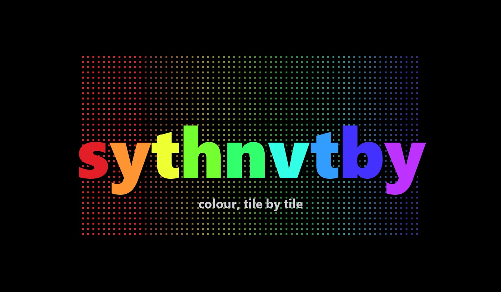
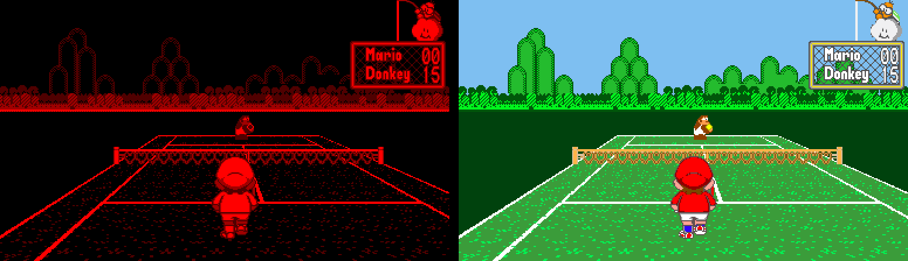
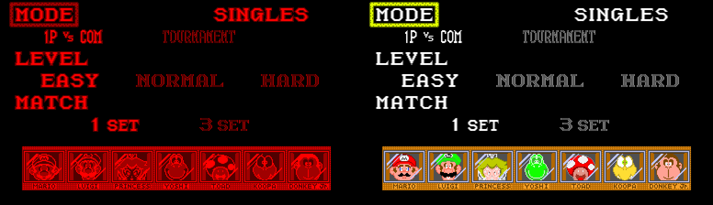
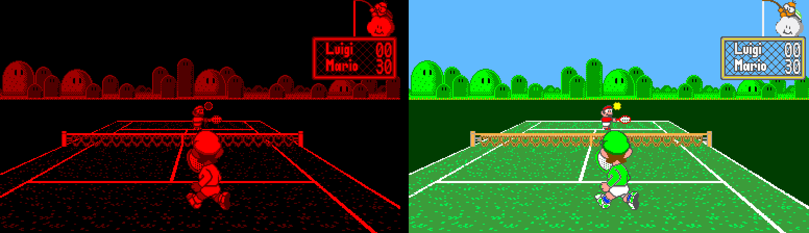
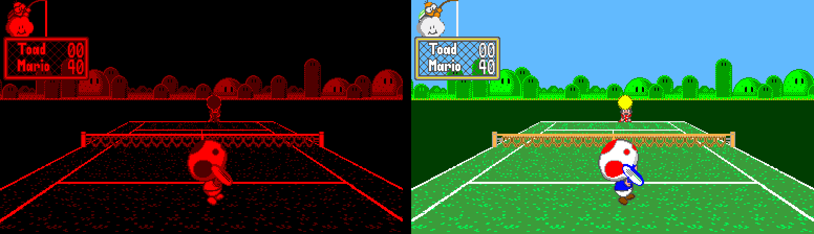
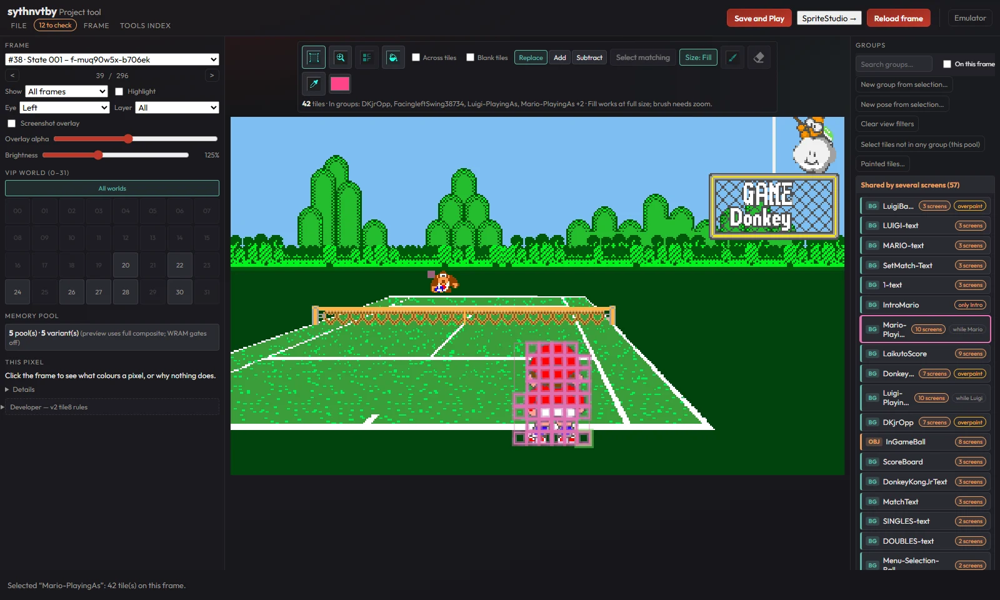
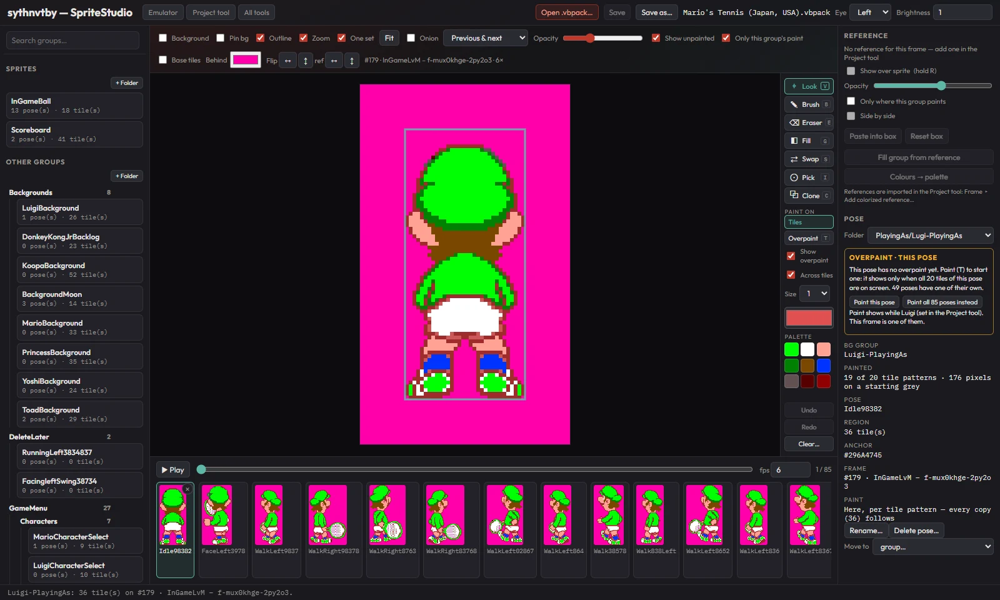

<p align="center"></p>

<p align="center"><b>Colour for red-screen 3D games, tile by tile — an emulator that runs in your browser, and the tools to colour a game yourself.</b></p>

<p align="center">
  <a href="https://github.com/nick-silva/sythnvtby/actions/workflows/ci.yml"></a>
  
  
</p>

sythnvtby plays Virtual Boy games in a browser tab and redraws every frame in colour from a
**colour project** you paint yourself — per tile, per character, per screen — while the original
red picture shows through wherever nothing is painted yet. Everything runs locally: no install,
no server, no account.

## Before and after

*Left: the game's own picture. Right: the same captured frame with our Mario's Tennis colour
project. Both halves are rendered from one capture (`scripts/readme-shots.mjs`). A project in
progress.*






## What it does

- **Colour by tile, with context.** Every 8×8 tile pattern can have its own colours, and a
  *group* can colour the same pattern differently elsewhere. A background can carry a
  hand-painted **overpaint** picture pinned to its map, and each pose of a character can have a
  picture of its own.
- **Knows which screen it's on.** Groups can be limited to some screens and to **game states**
  read from the game's memory ("Luigi is the player"), so shared tiles get the right colours.
- **Zooming backgrounds and 3D.** Scaled and rotated layers are coloured pixel by pixel as the
  game samples them; both eyes are coloured, for side-by-side and anaglyph 3D.
- **Follows the game.** Colours fade with the game's brightness and can follow its palette tricks.
- **Plays anywhere.** The emulator page; a small **player** for finished games (your ROM plus a
  play pack holding only colours); and a native C++ PC player with the same colour rules, checked
  pixel for pixel against the browser.
- **Monochrome and palette modes** too: the original red, or the four shades remapped to a preset.

## The authoring tools

**Project tool** — capture frames while you play, gather tiles into groups, limit them to
screens and game states, paint, and see *why* any pixel is (or isn't) coloured.



**SpriteStudio** — every pose of a character over the scene it was captured in, named
animations, painting across all poses at once, and pictures per pose. Paint a few poses and
**Auto-paint** colours the rest of the group from them (matching each pixel by what surrounds it,
not by position); **Original** shows the game's monochrome over your paint to check the result.



Also: **Check project** (finds what's wrong, with a fix for each), memory **game states** learned
from your recordings, auto-capture, recovery of unsaved work, and a play-pack export for the
player.

## How it works

The emulator core (a patched Beetle VB) reports what it drew each frame: every 8×8 tile, where,
and in which layer. The colour layer looks each tile up in your project and draws its colours
over the original picture, in the game's own depth order. A project is one `.vbpack` file holding
the captured frames, groups, game states and paint. More in the
[art pipeline](docs/reference/art-pipeline.md) and the [project guide](docs/README.md).

## Quick start

```bash
npm install
npm run dev          # then open http://localhost:5173
```

Load your own `.vb` ROM and play. **Capture Frame** (F8) and **Colorize!** take you into the
tools; the [user guide](docs/guide/user-guide.md) goes from a ROM to a coloured sprite in about 20
minutes. No games, ROMs or colour projects are included — use ROMs made from cartridges you own.

The app runs on the patched core in `public/data/` (`USE_LOCAL_CORE = true` in `src/main.js`);
colour mode, frame capture and memory analysis need it.

```bash
npm test             # lint + unit tests
npm run test:e2e     # browser suites; s0 needs no ROM: npm run test:e2e -- s0
npm run build        # static build in dist/
```

## Rebuilding the emulator core

You only need this if you change C/C++ in Beetle or RetroArch glue. The shipped WASM lives in `public/data/cores/`. See **[docs/core/core-build.md](docs/core/core-build.md)**.

## Docs

**Coloring a game?** Read the **[user guide](docs/guide/user-guide.md)**. It starts with a
TL;DR quick start, then covers the tools, the gotchas and a glossary.

**Working on the code?** Start with the **[project guide](docs/README.md)**: how the emulator, color layer and authoring tools fit together, the colorizing workflow, a code map, and a map of every doc — grouped into `reference/`, `core/`, `design/`, `planning/` and `history/`. Run `npm run docs:check` to find broken doc links and docs whose code has changed since they were last reviewed.

## Credits

sythnvtby is built on the work of these projects — thank you to everyone who made and shared them.

| Project | What we use it for | Licence |
|---|---|---|
| **[Beetle VB](https://github.com/libretro/beetle-vb-libretro)**, from **[Mednafen](https://mednafen.github.io/)** | The Virtual Boy emulator core, with our [patches](patches/) that report each frame's tiles | GPL-2.0-or-later |
| **[RetroArch](https://github.com/libretro/RetroArch)** | The libretro frontend the browser core is built with | GPL-3.0 |
| **[EmulatorJS](https://github.com/EmulatorJS/EmulatorJS)** | The loader and page glue that run the core in the browser (`public/data/`) | GPL-3.0 |
| ↳ [nipplejs](https://github.com/yoannmoinet/nipplejs), [Socket.IO client](https://github.com/socketio/socket.io) | Bundled with EmulatorJS (touch joystick, netplay) | MIT |
| ↳ [libunrar-js](https://github.com/tnikolai2/libunrar-js) | Bundled with EmulatorJS (opening `.rar` ROMs) | unRAR licence |
| **[Emscripten](https://emscripten.org/)** | Compiles the core to WebAssembly | MIT |
| **[JSZip](https://github.com/Stuk/jszip)**, **[fflate](https://github.com/101arrowz/fflate)** | Reading and writing project files | MIT / GPL-3.0, MIT |
| **[SDL2](https://www.libsdl.org/)** | Native PC player: window, sound, input | zlib |
| **[miniz](https://github.com/richgel999/miniz)**, **[nlohmann/json](https://github.com/nlohmann/json)**, **[stb_image](https://github.com/nothings/stb)** | Native PC player: reading play packs | MIT |
| **[Outfit](https://fonts.google.com/specimen/Outfit)**, **[IBM Plex Mono](https://fonts.google.com/specimen/IBM+Plex+Mono)** | Fonts, loaded from Google Fonts | SIL OFL 1.1 |

Every component, its licence and where the core's source comes from: [NOTICE](NOTICE).

## License

**GPL-3.0-or-later** — see [LICENSE](LICENSE) and [NOTICE](NOTICE). Games, ROMs and the colour
projects you make are not covered; don't share a `.vbpack` that holds a ROM you may not
distribute.

*sythnvtby is an independent fan project, not affiliated with, endorsed by or sponsored by
Nintendo. "Virtual Boy" and the games shown are trademarks of Nintendo; the screenshots are shown
only to illustrate the project.*
