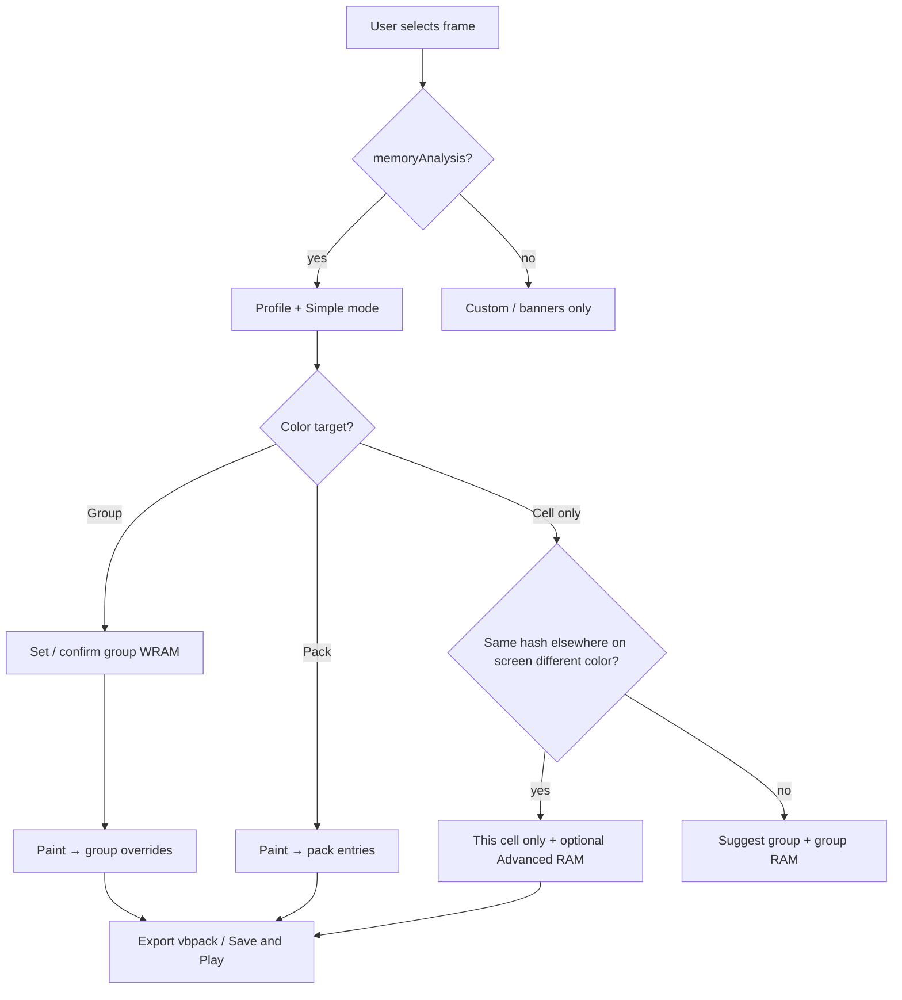

# Paint tool — simplified authoring (profiles + UI spec)

**Status:** **Implemented** in `tools/paint.html` + `tools/paint.js` (March 2026): Advanced toggle + profile bar, Color target Pack/Group, From current window, group RAM defaults + opt-out flag, simplified labels, global-scope hint alignment with Advanced. **Audience:** product + implementers. **Platform:** desktop web only (unchanged from [paint-tool-overrides-redesign-spec.md](paint-tool-overrides-redesign-spec.md)).

**Builds on:** [paint-tool-overrides-practical-guide.md](paint-tool-overrides-practical-guide.md), [paint-tool-overrides-redesign-spec.md](paint-tool-overrides-redesign-spec.md), [paint-tool-wireframe-spec.md](paint-tool-wireframe-spec.md), [group-override-design.md](../../design/group-override-design.md).

---

## 1. Goals

| Goal | Success |
|------|---------|
| **Reduce cognitive load** | One primary story: **pack** (global) vs **scoped** color (group + optional **same-cell** disambiguation). |
| **Match real screens** | First-class **authoring profiles** for safety text, splash, and complex multi-window intros — without inventing new runtime formats. |
| **RAM-first** | When `manifest.memoryAnalysis` exists, **game-state (WRAM)** is the **default gate** for scoped work; opting out is **explicit** (“Apply everywhere in the game”) with a short warning. |
| **No false simplification** | **Position / cell overrides** remain available where **groups cannot** disambiguate (same hash, same layer/window/state, two different colors). |

---

## 2. Design principles

1. **Profiles are UX sugar, not new pack fields.** All work still maps to existing `overrides.json`, `groups.json`, `ramConditions`, rects, `groupId`, etc.
2. **Single RAM “headline.”** Authors should mostly see **one** place for “when does this apply?” — the **group’s Game-state** block — with **Advanced** revealing non-group RAM and positional-only flows.
3. **Groups are the default container for “this screen’s art.”** Encourage **one group per window (or merged windows)** + **group RAM** instead of dozens of non-group overrides with repeated RAM.
4. **Progressive disclosure.** **Simple** mode hides: non-group game-state, “everywhere this layer” (non-group), preview-only tools that ignore RAM, until user chooses **Advanced** or a profile explicitly needs them.
5. **Emulator runtime** may still lag (RAM evaluation); spec describes **authoring** and **export** truth. See practical guide §7.

---

## 3. Authoring profiles (screen archetypes)

Profiles appear in the UI as **optional shortcuts** (dropdown or “Start from…”): *Simple safety*, *Splash / title*, *Layered intro*, *Custom (current)*.

### 3.1 Profile A — **Simple safety** (one window, full-screen text, shared glyphs)

**Intent:** Many alphabet tiles; **only** this screen should use these colors; **one VIP window** dominates; minimal grouping friction.

**Recommended authoring path (spec):**

1. User chooses profile **Simple safety** or accepts suggestion when **one window** + **many draws** + analysis present.
2. Tool offers **Create group from visible window** (pre-filled `windowIds: [current]`, no hashes yet) → **Add** selection or **Select all (visible)** → user adds hashes.
3. **Game-state (WRAM)** on that group: **auto-suggested** from current frame’s `frameRegistry` + top memory candidate (see §5.3). User confirms or adjusts once.
4. User selects group as paint target → paints (group overrides) **or** uses **Override from pack** then tweaks.

**Why not “no group”:** Fewer repeated RAM attachments; one checkbox + one state + one candidate for the whole screen. User’s “no group” preference is satisfied **conceptually** (“I think of this as one window”) while data stays **one group + group RAM**.

**Escape hatch:** If user **refuses** the group, **Advanced → non-group position overrides + per-override RAM** remains valid (existing behavior).

### 3.2 Profile B — **Splash / title**

**Intent:** **Everything** gated by game state; **same hash** may need **different colors in two places** on the **same** splash (same WRAM).

**Path:**

1. **Groups + group RAM** for the bulk (per window / per layer / per “element” where hashes differ).
2. **Same-hash, two places (same window/layer/state):** **Cell override** mode — **Apply to: This cell only** (either with **no group** or future **“split within group”** UX that still emits position-bounded overrides; see §8).

**Education copy (banner or profile blurb):** “If two letters look identical but need different colors, use **This cell only** — groups can’t split the same tile hash twice.”

### 3.3 Profile C — **Layered intro** (windows, BG vs OBJ, image round-trip)

**Intent:** Organize by **window**; sometimes **merge adjacent windows** (BG + OBJ) into **one group**; **filled tiles** → solid colors per group; optional **substate** via duplicate group + different `ramConditions`; heavy use of **Export scene** → external paint → **staging** → **Copy to tile editor**.

**Path:**

1. Create **one group per logical layer stack** (criteria: `windowIds: [w0, w1, …]` as needed, `layers` optional).
2. **Group RAM** per capture / substate as needed (duplicate group for variants).
3. **Export scene** (filtered to group when painting that stack) → external tool → **Load image** on staging → align → **Copy to tile editor** for selected draws; repeat per group / export pass.

**Filled tiles:** No special format — **solid RGBA** in pack or group override; profile may show a tip: “Select group → flood or fill in tile editor for repeated `#` hashes.”

### 3.4 Profile D — **Custom (expert)**

Exposes **full** current UI (no hiding). Same as today’s layout philosophy in [paint-tool-wireframe-spec.md](paint-tool-wireframe-spec.md).

---

## 4. UI model — modes

### 4.1 **Simple** (default for new sessions when analysis exists)

| Visible (primary column) | Hidden or collapsed |
|--------------------------|---------------------|
| Frame selector, pack load, exports | — |
| **Groups** list + expand (criteria, **Game-state WRAM**, Override from pack, Add/Remove, Duplicate) | Long explanatory footnotes minimized |
| **Pack vs scoped** — single control replacing two mental steps | **Details** |
| **Apply to:** **Everywhere (pack)** vs **This cell only (override)** | “Everywhere (this layer)” (non-group) |
| Tile painter (palette, canvas, staging block) | Non-group **Game-state** checkbox block |
| **Game-state** only **inside expanded group** | “Preview override match” (or tooltip-only) |
| Override presets (compact) | — |

**Pack vs scoped (spec copy):**

- **Color the pack** — Same as current **Apply to: Everywhere** with **no paint-target group** (or explicit “pack” target).
- **Color this screen / this group** — Requires **paint-target group**; commits go to **group overrides**; **WRAM** on the group is **on by default** when analysis exists (user must **turn off** “Only in this game state” to opt into global-scoped group work — with warning).

### 4.2 **Advanced** (toggle: “Show all override options”)

Restores:

- Non-group **Game-state condition** block on **This cell only**.
- **Everywhere (this layer)** for non-group overrides.
- **Preview override match** (with explicit label: *spatial/layer only — not RAM*).
- Full inline help for `worldIds` / legacy naming if any.

---

## 5. New / revised affordances (spec)

### 5.1 **Create group from current window**

- **Trigger:** Profile **Simple safety**; or button next to **New group** when a **draw is selected** or **window filter** is effective.
- **Effect:** New group with `windowIds` prefilled from selected draw’s `world` (or visible set’s common window if unambiguous).
- **Follow-up:** Focus **Add** flow or **Select all (visible)** with copy: “Add letters for this screen.”

### 5.2 Rename **Override** (group row) → **Copy pack colors into this group**

- Reduces collision with **override** as a noun everywhere else.
- Tooltip: current behavior — bulk-create `groupId` overrides from pack entries for hashes in the group.

### 5.3 **RAM auto-suggest (group)**

When:

- `manifest.memoryAnalysis` present,
- paint-target group selected **or** user expands **Game-state**,
- current frame maps to a `frameRegistry` entry with `stateName` / `subStateName`,

then:

- Pre-select **State** dropdown to that family (best match from registry).
- Pre-select **Candidate** to **top discriminant** for that state (or first candidate if ambiguous).

User can change; suggestion **re-applies** when **frame** changes (with confirm if it would overwrite unsaved RAM edits — implementation detail).

### 5.4 **Global-only warning** (scoped work without RAM)

If user toggles **Only in this game state** **off** on a group **while** memory analysis exists:

- Amber inline: “These colors may apply **in every level** where this group matches. Turn game-state on to limit to **{state}**.”

Same spirit as existing opt-out copy for non-group paths; unified wording.

### 5.5 **Profile picker** (optional v1)

- Placement: below memory-analysis banners, above **Groups**.
- **Persistence:** `sessionStorage` key `paint.authoringProfile`; default `simple-safety` when analysis exists, else `custom`.

---

## 6. Wireframe — Simple mode (target)

```
┌────────────────────────────────────────────────────────────────────────────┐
│ Paint-on-game   [Authoring: Simple safety ▼]  [ ] Advanced override options │
├────────────────────────────────────────────────────────────────────────────┤
│ MEMORY / ANALYSIS BANNERS (unchanged)                                       │
├────────────────────────────────────────────────────────────────────────────┤
│ TOOLBAR (unchanged)                                                         │
├──────────────────────────────┬─────────────────────────────────────────────┤
│ SCENE 384×224                │ Color target:  ( ) Pack   ( ) This group ○    │
│                              │     ↑ radio ties to paint-target group list   │
│                              │ Groups                                        │
│                              │  • [radio] Safety text   [Copy pack colors…]  │
│                              │     expanded: windows, hashes, counts         │
│                              │     ☑ Only in this game state (WRAM)          │
│                              │        State [ … ]  Candidate [ … ]          │
│                              │  • [ ] Other group…                          │
│                              │ [New group] [From current window]             │
│                              │ Override presets (compact)                    │
│                              │ Draws at click                                │
│                              │ Apply: ( ) Everywhere — pack  ( ) This cell only│
│                              │   (layer / cell-only suboptions if 2nd radio)  │
│                              │ Tile painter + staging / import               │
└──────────────────────────────┴─────────────────────────────────────────────┘
```

**Notes:**

- **Color target: Pack | This group** replaces the need to explain “no group vs group” twice if we bind **This group** directly to the **radio** in the list (selected group highlighted). **Alternative:** keep separate “None” for paint target but spec prefers explicit **Pack** vs **Group: {name}** in one control — implementation choice; behavior must match exclusive hash rules.

- When **This cell only** is selected in Simple mode **without** a group target: show one-line banner: “**Tip:** For a whole screen, create a group (e.g. **From current window**) so you set **WRAM once.**” Link **Advanced** if they need non-group RAM.

---

## 7. Flow — decision (Mermaid)



---

## 8. Open questions (implementation)

| # | Question | Default recommendation |
|---|----------|------------------------|
| 1 | Bind **Color target** radio to **group list** radio 1:1? | **Yes** — one source of truth; **Pack** clears group target. |
| 2 | **Simple safety** auto-create group on first paint in a window? | **No** — offer **From current window** + toast; avoid surprise groups. |
| 3 | **Splash** profile: auto-enable **Advanced** when user selects **This cell only** twice for same hash? | Optional heuristic; **v2**. |
| 4 | Substate duplicate groups: template action **Duplicate group for new sub-state**? | Nice **v1.5**; copies criteria, clears RAM until user picks new candidate. |

---

## 9. Phasing

| Phase | Scope |
|-------|--------|
| **1** | **Advanced** toggle + hide non-group RAM + hide “everywhere this layer” + relabel group **Override** button + unified global-only warning on group RAM off. |
| **2** | **From current window** + profile dropdown (minimal: labels + banner copy only). |
| **3** | **RAM auto-suggest** from `frameRegistry` + analysis; confirm/overwrite rules when switching frames. |
| 4 | Optional: **Color target Pack | Group** header control + dedupe explanatory copy. |

**Shipped (March 2026):** Phases 1–2 + color target + group RAM-first defaults. Group WRAM defaults **on** when analysis exists unless the author opts out (`_authoringRamOff` in memory only, not exported). Non-group WRAM is omitted from exports while Advanced is off. Presets using “everywhere (this layer)” clamp to **cell** in Simple mode. Registry-based candidate pick for groups was already present; frame switch now rebuilds group UI so state/candidate stay aligned.

---

## 10. What we are explicitly not doing in this spec

- New pack file fields beyond existing `ramConditions` / groups.
- Mobile layout.
- Emulator **runtime** RAM evaluation (tracked separately in codebase).

---

## 11. Changelog

| Date | Change |
|------|--------|
| 2026-03-24 | Initial spec: profiles A–D, Simple vs Advanced UI, wireframe, flows, phasing, open questions. |
| 2026-03-24 | Paint tool implementation: authoring bar, Color target, From current window, Advanced disclosure, group RAM-first defaults, `_authoringRamOff`. |

---

## 12. Related implementation specs

| Doc | Role |
|-----|------|
| [paint-tool-overrides-redesign-spec.md](paint-tool-overrides-redesign-spec.md) | Locked data rules: one RAM per group, presets, warnings — **still authoritative** for export/runtime shape. |
| [paint-tool-wireframe-spec.md](paint-tool-wireframe-spec.md) | v1 layout reference; this doc’s §6 is the **Simple-mode** target layout. |
